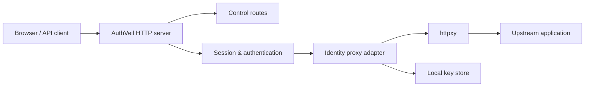
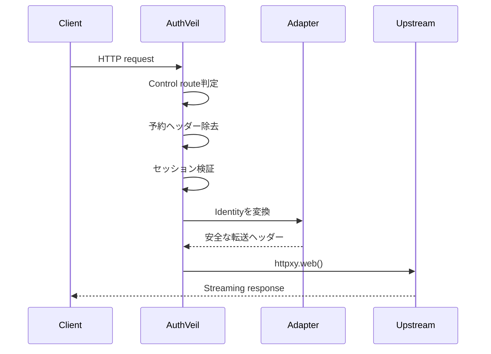
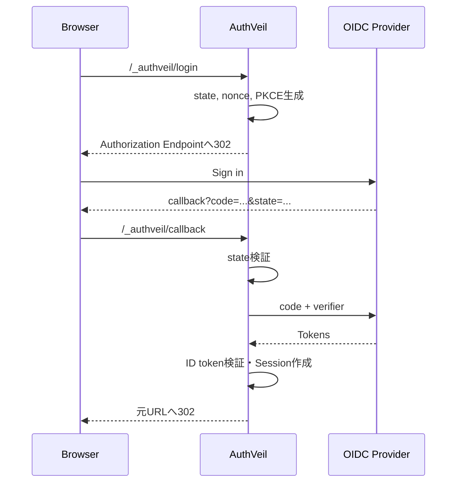

# AuthVeil 詳細設計書

Mirror cloud identity proxies locally.

## 1. プロジェクト名

### 1.1 推奨名称

**AuthVeil**

本番環境に存在するクラウドの認証境界を、ローカル開発環境へ「写す（mirror）」ことを表す。

- 特定クラウドの名称に依存しない
- 認証サーバーそのものではなく、認証済みリクエストを再現する製品だと説明しやすい
- CLI 名、npm パッケージ名、設定ファイル名へ自然に展開できる

```text
authveil
authveil start
authveil.config.yaml
AUTHVEIL_UPSTREAM
```

タグライン案：

> Mirror cloud identity proxies locally.

日本語での説明：

> IAP、ALB OIDC、Entra Application Proxy の認証済みリクエストをローカルで再現する開発用リバースプロキシ

2026-07-27 時点の予備調査では、同名の著名な認証系 OSS および npm パッケージは確認できていない。ただし、公開前に npm、GitHub、主要コンテナレジストリ、ドメイン、商標を改めて確認する。

### 1.2 代替名称

| 候補                | 意味                                  | 評価                                                     |
| ------------------- | ------------------------------------- | -------------------------------------------------------- |
| AuthVeil            | 本番の認証境界をローカルへ写す        | **推奨**。用途と一致し、特定ベンダーに依存しない         |
| ClaimSwitch         | identity claim の出力形式を切り替える | Adapter 機能は伝わるが、リバースプロキシであることが弱い |
| Local Identity Edge | ローカルの identity-aware edge        | 説明的だが、製品名としては長い                           |
| ProxyClaims         | Proxy が claims を注入する            | 直接的だが、やや一般名詞的                               |

以降、本書では製品名を **AuthVeil** とする。

---

## 2. 背景

Google Cloud Identity-Aware Proxy、AWS Application Load Balancer の OIDC 認証、Microsoft Entra Application Proxy は、アプリケーションの前段でユーザーを認証し、認証結果をHTTPヘッダーや署名付きトークンとしてバックエンドへ渡す。

バックエンドアプリケーションは本番環境ではこれらの認証情報を受け取れるが、ローカル開発では次の問題が発生する。

- クラウド上の認証プロキシを毎回用意しないと、認証後のアプリケーションを再現できない
- プロバイダーごとにヘッダー名、JWT形式、信頼モデルが異なる
- WebSocket や SSE を使用するアプリでは、簡易モックサーバーで通信挙動を再現しにくい
- 実際のOIDC Providerと接続したローカル統合テストも行いたい

AuthVeil は、これらのクラウド認証プロキシを完全に再実装するものではない。認証プロキシを通過した後にバックエンドが観測するリクエストを、ローカルで安全かつ再現可能に生成する。

---

## 3. 目的と非目的

### 3.1 目的

1. IAP、ALB OIDC、Entra Application Proxy に相当する認証済みHTTPヘッダーを生成する
2. 固定ユーザーまたはユーザー選択画面による高速なローカル開発を可能にする
3. 任意のOIDC Providerを使ったAuthorization Code Flowをローカルで実行する
4. HTTP、SSE、WebSocketを透過的にバックエンドへ転送する
5. ES256署名鍵とローカル公開鍵エンドポイントを提供する
6. アプリケーション側で利用できる検証SDKを提供する
7. プロバイダー固有処理をAdapterとして追加できる構造にする
8. npm CLIおよびコンテナとして容易に起動できるようにする

### 3.2 非目的

以下は AuthVeil の責務に含めない。

- Google Cloud IAP、AWS ALB、Entra Application Proxy の完全なエミュレーション
- IAM、Conditional Access、組織ポリシー、端末準拠性評価の再現
- 本番環境のアクセス制御基盤
- 汎用Forward Proxy
- WAF、ロードバランサー、TLS終端製品の代替
- IdPそのものの実装
- 本物のGoogleまたはAWS秘密鍵による署名
- 本物と同等のアクセストークンの合成
- Entra Application Proxy Connectorプロトコルの再実装
- ユーザー・パスワードの永続管理

### 3.3 製品ポジション

AuthVeil は、**development-only identity-aware reverse proxy** と位置付ける。

README、CLI起動ログ、コンテナラベル、ドキュメントのすべてで、本番用セキュリティ境界ではないことを明示する。

---

## 4. 対象ユースケース

### 4.1 固定ユーザーによる開発

開発者が設定ファイルへユーザーを定義し、AuthVeil経由でバックエンドへアクセスする。AuthVeilは選択されたユーザーを、指定したプロバイダー形式へ変換する。

```text
Browser -> AuthVeil :3080 -> Application :8080
```

### 4.2 複数権限ユーザーの切り替え

管理者、一般ユーザー、未所属ユーザーなどをローカルUIから切り替え、バックエンドの認可処理を確認する。

### 4.3 実OIDC Providerを使った統合

Google、Microsoft Entra ID、Keycloak、CognitoなどのOIDC Providerで実際にログインし、取得したclaimsをALB/IAP/任意ヘッダー形式へ変換する。

### 4.4 JWT検証ロジックのテスト

ローカル公開鍵URLをアプリケーション側のJWT検証処理へ設定し、以下を検証する。

- 正常な署名
- 不正な署名
- 期限切れ
- issuer不一致
- audience不一致
- `kid` 不一致
- ALB `signer` 不一致

### 4.5 SSEとWebSocket

認証済みセッションからSSEまたはWebSocket接続を開始し、通常HTTPと同じidentityをバックエンドへ渡す。WebSocket転送は常に有効とする。

---

## 5. 互換性の定義

AuthVeil の「互換」は3段階に分ける。

| レベル               | 定義                                                   | v0.1   |
| -------------------- | ------------------------------------------------------ | ------ |
| Header compatibility | ヘッダー名と値の形状が対象サービスと一致する           | 対応   |
| Claim compatibility  | JWT header/payloadの主要claimsが対象サービスと一致する | 対応   |
| Trust compatibility  | ベンダー公式公開鍵および公式Verifierで検証できる       | 非対応 |

本物のIAPやALBの秘密鍵は利用できないため、ローカルで生成したJWTをベンダー公式公開鍵では検証できない。アプリケーションは開発時にのみ、AuthVeilの公開鍵URLを使ってJWTを検証する。

互換性は「semantic compatibility」を目標とし、暗号署名やベンダー内部Cookieを含むbyte-for-byte互換は目標にしない。

---

## 6. 機能要件

### 6.1 コア要件

| ID     | 要件                                                     |
| ------ | -------------------------------------------------------- |
| FR-001 | 固定された単一upstreamへHTTPリクエストを転送できる       |
| FR-002 | レスポンスをバッファリングせずストリーム転送できる       |
| FR-003 | SSEを透過的に転送できる                                  |
| FR-004 | WebSocket Upgradeを転送できる                            |
| FR-005 | 転送前に外部入力された予約identityヘッダーを削除する     |
| FR-006 | 認証済みidentityからプロバイダー形式のヘッダーを生成する |
| FR-007 | 認証されていない通常HTTPアクセスをログインへ誘導する     |
| FR-008 | 未認証WebSocket接続を明示的に拒否する                    |
| FR-009 | ヘルスチェックと準備完了チェックを提供する               |
| FR-010 | 設定ファイルと環境変数を検証し、誤設定時は起動に失敗する |

### 6.2 認証モード

| モード   | 説明                                       | v0.1               |
| -------- | ------------------------------------------ | ------------------ |
| `mock`   | 静的ユーザーまたはユーザー選択UIを利用     | 必須               |
| `oidc`   | 外部OIDC Providerへログイン                | 必須               |
| `verify` | 実プロキシの証明を検証し、正規化して再転送 | 未実装（v0.2候補） |

### 6.3 出力プロファイル

| プロファイル      | 説明                                                    |
| ----------------- | ------------------------------------------------------- |
| `alb`             | AWS ALB OIDC authentication互換                         |
| `iap`             | Google Cloud IAP signed headers互換                     |
| `entra-app-proxy` | Entra Application Proxyの設定可能なheader-based SSO互換 |
| `generic`         | 任意claimsから任意ヘッダーへのマッピング                |
| `none`            | identityヘッダーを生成しない                            |

### 6.4 鍵管理

| ID         | 要件                                                             |
| ---------- | ---------------------------------------------------------------- |
| FR-KEY-001 | ES256鍵ペアを起動時に生成できる                                  |
| FR-KEY-002 | PEMまたはJWK形式の永続鍵を読み込める                             |
| FR-KEY-003 | JWKSエンドポイントを提供する                                     |
| FR-KEY-004 | ALB風のPEM公開鍵エンドポイントを提供する                         |
| FR-KEY-005 | `kid` を安定して計算または明示指定できる                         |
| FR-KEY-006 | 秘密鍵をログ・エラー・管理APIへ出力しない                        |
| FR-KEY-007 | テスト用に期限切れ、不正issuerなどのトークンを明示的に生成できる |

### 6.5 セッション

| ID         | 要件                                           |
| ---------- | ---------------------------------------------- |
| FR-SES-001 | ブラウザセッションをCookieで識別する           |
| FR-SES-002 | CookieにはidentityやOIDC tokenを直接格納しない |
| FR-SES-003 | セッションIDは暗号学的乱数で生成する           |
| FR-SES-004 | ログアウト時にセッションを失効する             |
| FR-SES-005 | 有効期限切れセッションを遅延削除する           |
| FR-SES-006 | プロセス終了時にインメモリセッションを破棄する |

---

## 7. 非機能要件

### 7.1 性能

- 認証済みのwarm requestにおけるAuthVeil追加レイテンシーを、ローカル環境のp95で10ms未満を目標とする
- リクエスト・レスポンスbodyを原則バッファリングしない
- JWTは短時間セッションキャッシュし、毎リクエストの署名処理を避ける
- WebSocketおよびSSEの接続時間に製品独自の上限を設けない
- keep-aliveをデフォルトで有効にする

性能値はリリース判定の絶対保証ではなく、標準ベンチマーク環境で継続観測する目標値とする。

### 7.2 可用性

- ローカル開発ツールであるため、クラスタリングや高可用性は対象外
- upstream接続失敗時は `502 Bad Gateway`
- upstreamタイムアウト時は `504 Gateway Timeout`
- OIDC Providerへの到達不能は認証用エラーページに表示する
- 設定不備や鍵不備はfail-fastとする

### 7.3 可搬性

- Node.js 24以上
- Windows、macOS、Linux
- WSL2
- Docker / Docker Compose
- amd64、arm64

### 7.4 依存関係

コア実行時依存は以下を基本とする。

| パッケージ      | 用途                                      |
| --------------- | ----------------------------------------- |
| `httpxy`        | HTTP、SSE、WebSocketのリバースプロキシ    |
| `jose`          | JWT/JWS、JWK、JWKS、ES256                 |
| `openid-client` | OIDC Discovery、Authorization Code + PKCE |
| `yaml`          | YAML設定ファイル                          |
| `ajv`           | 設定スキーマ検証                          |
| `pino`          | 構造化ログ                                |

`aws-jwt-verify` は `verify` モードまたはAWS向け検証SDKの依存とし、プロキシ本体の必須依存にはしない。

---

## 8. システムアーキテクチャ



### 8.1 コンポーネント

#### HTTP Server

Node.js標準 `node:http` / `node:https` を使用する。FastifyやExpressをプロキシの必須基盤にはしない。

責務：

- 通常HTTPリクエストの受信
- WebSocket Upgradeの受信
- 内部control routeとupstream routeの分岐
- graceful shutdown

#### Route Dispatcher

予約prefixをAuthVeil内部エンドポイントとして扱い、それ以外をupstreamへ渡す。

デフォルトprefix：

```text
/_authveil
```

予約prefixは設定で変更できる。upstreamには転送しない。

#### Authenticator

`mock` と `oidc` から `ProxyIdentity` を生成する。

#### Session Store

デフォルトはインメモリ実装とする。ローカルツールであるためRedisなどの外部ストアは導入しない。

#### Identity Proxy Adapter

共通identityをALB、IAP、Entra Application Proxyまたはgeneric形式のヘッダーへ変換する。

#### Key Store

秘密鍵、公開鍵、`kid`、鍵の有効状態を保持する。署名処理と公開鍵エンドポイントを提供する。`keys.privateKey` は PEM または JWK の鍵そのもの、`keys.privateKeyFile` は鍵ファイルを指定し、両者は排他とする。後者の相対パスは設定ファイル基準で解決する。ファイルがなければ ES256 鍵を生成して `0600` で保存し、どちらもなければ一時鍵を生成する。

#### Reverse Proxy

`httpxy` を使用し、HTTP、SSE、WebSocketをupstreamへ転送する。

---

## 9. リクエスト処理

### 9.1 通常HTTP



処理順：

1. リクエストサイズおよびURLを検査する
2. control routeなら内部ハンドラーへ渡す
3. 外部入力の予約ヘッダーを削除する
4. セッションを検証する
5. 未認証ならログインへリダイレクトする
6. `ProxyIdentity` を取得する
7. Identity Proxy Adapterで転送ヘッダーを生成する
8. 生成ヘッダーのサイズ上限を確認する
9. `httpxy.web()` を呼ぶ
10. upstream responseをストリーム転送する

### 9.2 OIDCログイン



必須検証：

- `state`
- `nonce`
- Authorization Code Flow
- PKCE S256
- issuer
- audience/client ID
- token signature
- `exp`

OIDC access tokenとrefresh tokenはログへ出力しない。MVPではrefresh tokenを永続化しない。

### 9.3 WebSocket

WebSocket UpgradeではブラウザがOIDCリダイレクトを通常のページ遷移として処理できない。そのため、未認証Upgradeは `401 Unauthorized` で拒否する。

```text
HTTP/1.1 401 Unauthorized
Connection: close
X-AuthVeil-Login: /_authveil/login
Content-Length: 0
```

`iap` プロファイルでは `X-Goog-IAP-Generated-Response: true` も付与する。control prefix 配下へのUpgradeはupstreamへ転送せず `404` で拒否する。

認証済みの場合：

1. Cookieからセッションを検証する
2. 予約ヘッダーを削除する
3. identityヘッダーを生成する
4. `httpxy.ws()` へ渡す

### 9.4 SSE

SSEは通常HTTPと同じ `proxy.web()` を使用する。以下を保証する。

- response bodyをバッファリングしない
- `Content-Type: text/event-stream` を変更しない
- connection単位の製品独自タイムアウトを設けない
- 圧縮やbody変換を行わない

---

## 10. ドメインモデル

### 10.1 ProxyIdentity

```ts
export interface ProxyIdentity {
  readonly subject: string;
  readonly email?: string;
  readonly name?: string;
  readonly claims: Readonly<Record<string, JsonValue>>;
  readonly source: IdentitySource;
}

export interface IdentitySource {
  readonly mode: "mock" | "oidc" | "verified";
  readonly issuer?: string;
  readonly authenticatedAt: number;
}
```

要件：

- `subject` は必須で空文字を許可しない
- `claims` はJSON互換値のみ許可する
- `groups` を含む、`sub`、`email`、`name` 以外の claim は `claims` に保持する
- access tokenやrefresh tokenは含めない

### 10.2 Evidence

`verify` モードではidentityの根拠を保持する。

```ts
export type IdentityEvidence =
  | {
      kind: "signed-jwt";
      issuer: string;
      audience?: string | readonly string[];
      keyId: string;
    }
  | {
      kind: "trusted-proxy-headers";
      remoteAddress: string;
    }
  | {
      kind: "local";
      profileId: string;
    };
```

`trusted-proxy-headers` は、明示されたCIDRまたはloopbackから到達した場合のみ生成できる。

### 10.3 Adapter

```ts
export interface IdentityProxyAdapter {
  readonly type: "alb" | "iap" | "entra-app-proxy" | "generic" | "none";

  createHeaders(
    identity: ProxyIdentity,
    context: AdapterContext,
  ): Promise<Readonly<Record<string, string>>>;

  reservedHeaderNames(): readonly string[];
}

export interface AdapterContext {
  readonly now: Date;
  readonly keyStore: SigningKeyStore;
  readonly requestId: string;
  /** gcp-iap-mode=SECURE_TOKEN_TEST で再現する検証失敗 */
  readonly iapSecureTokenTestType?: IapSecureTokenTestType;
}
```

### 10.4 Authenticator

```ts
export interface Authenticator {
  resolve(request: IncomingMessage): Promise<AuthResult>;
}

export type AuthResult =
  | { authenticated: true; identity: ProxyIdentity; sessionId?: string; accessToken?: string }
  | { authenticated: false; reason: "missing" | "expired" | "invalid" };
```

### 10.5 SigningKeyStore

```ts
export interface SigningKeyStore {
  current(): Promise<SigningKey>;
  publicJwks(): Promise<JsonWebKeySet>;
  publicPem(keyId: string): Promise<string | undefined>;
}

export interface SigningKey {
  readonly keyId: string;
  readonly algorithm: "ES256";
  sign(payload: SignableClaims, header: JoseHeader): Promise<string>;
}
```

---

## 11. プロバイダー別設計

### 11.1 AWS ALB OIDC

#### 生成ヘッダー

```http
x-amzn-oidc-data: <AuthVeil-signed JWT>
x-amzn-oidc-identity: <subject>
x-amzn-oidc-accesstoken: <IdP access token or AuthVeil-signed local access token>
```

`x-amzn-oidc-accesstoken` は常に付与する。`oidc` モードでIdPからaccess tokenを取得した場合はその値を使用し、`mock` モードではAuthVeilの署名鍵でローカルaccess tokenを生成する。

`alb` プロファイルではセッションCookie名の既定値をALBの最初のshardと同じ `AWSELBAuthSessionCookie-0` とする。Hostは `preserveHostHeader: false`（既定）でlisten portを付けたAuthVeilのhostへ正規化し、`X-Forwarded-For`、`X-Forwarded-Proto`、`X-Forwarded-Port` をALBの形式で再生成する。

#### JOSE header

```json
{
  "alg": "ES256",
  "kid": "local-key-id",
  "signer": "arn:aws:elasticloadbalancing:ap-northeast-1:000000000000:loadbalancer/app/authveil/local",
  "iss": "https://issuer.example.com",
  "client": "local-client-id",
  "exp": 1785164400
}
```

#### Payload

```json
{
  "sub": "local-user-001",
  "email": "developer@example.com",
  "name": "Local Developer",
  "groups": ["developers"]
}
```

#### 設定

```yaml
identityProxy:
  type: alb
  preserveHostHeader: false
  albArn: arn:aws:elasticloadbalancing:ap-northeast-1:000000000000:loadbalancer/app/authveil/local
  issuer: https://issuer.example.com
  clientId: local-client-id
  tokenTtl: 5m
```

#### 制限

AWS公式の公開鍵URLにはAuthVeilの公開鍵を配置できない。アプリ側は開発時のみ `AUTHVEIL_JWKS_URL` を使う。

### 11.2 Google Cloud IAP

#### 生成ヘッダー

```http
x-goog-iap-jwt-assertion: <AuthVeil-signed JWT>
x-goog-authenticated-user-email: accounts.google.com:developer@example.com
x-goog-authenticated-user-id: accounts.google.com:local-user-001
```

#### JWT header

```json
{
  "alg": "ES256",
  "kid": "local-key-id"
}
```

#### JWT payload

```json
{
  "iss": "https://cloud.google.com/iap",
  "aud": "/projects/000000000000/global/backendServices/0000000000000000000",
  "sub": "local-user-001",
  "email": "developer@example.com",
  "iat": 1785164100,
  "exp": 1785164700
}
```

#### 設定

```yaml
identityProxy:
  type: iap
  audience: /projects/000000000000/global/backendServices/0000000000000000000
  issuer: https://cloud.google.com/iap
  identityNamespace: accounts.google.com
  tokenTtl: 10m
```

#### 特殊なquery parameter

| Query                             | 動作                                                                                     |
| --------------------------------- | ---------------------------------------------------------------------------------------- |
| `gcp-iap-mode=IDENTITY`           | namespace付きの `email` と `sub` をJSONで返す                                            |
| `gcp-iap-mode=CLEAR_LOGIN_COOKIE` | セッションを削除してCookieを失効させ、IAPのparameterを除いた同じURLへリダイレクトする    |
| `gcp-iap-mode=SECURE_TOKEN_TEST`  | `iap-secure-token-test-type` に応じて期限切れ、issuer不一致などのテスト用assertionを送る |

IAPエミュレーションが生成したレスポンスには `X-Goog-IAP-Generated-Response: true` を付与する。Hostは既定でクライアントの値を保持し、`hostRewrite` 指定時のみ置き換える。

#### 制限

Google公式IAP公開鍵では検証できない。アプリの開発モードで公開鍵URLを差し替える必要がある。

### 11.3 Microsoft Entra Application Proxy

Entra Application Proxyのheader-based SSOでは、ヘッダー名と値を管理者が構成する。このため、固定の「Entra標準ヘッダー」を定義しない。

#### 設定

```yaml
identityProxy:
  type: entra-app-proxy
  translateUrlsInHeaders: true
  headers:
    X-Remote-User-Id:
      claim: sub
    X-Remote-User-Email:
      claim: email
    X-Remote-User-Name:
      claim: name
    X-Remote-User-Groups:
      claim: groups
      transform: join
      separator: ","
```

#### 対応transform

v0.1では意図的に機能を限定する。

| transform | 動作                        |
| --------- | --------------------------- |
| `string`  | scalarを文字列化            |
| `join`    | 文字列配列をseparatorで結合 |
| `json`    | JSON文字列化                |
| `prefix`  | 固定prefixを付与            |

任意JavaScript、テンプレート式、外部コマンド実行は許可しない。

#### URL変換

`translateUrlsInHeaders: true`（既定）では、upstreamへのHostを `upstream.url` のhostにし、レスポンスの `Location`、`Content-Location` と `Set-Cookie` の `Domain` のうちupstreamのoriginに一致するものをクライアント側のoriginへ変換する。`false` ではHostを保持し、変換しない。

#### 信頼モデル

実際のEntra Application Proxyでは、バックエンドがConnector以外から到達不能であることが重要な信頼境界になる。AuthVeilでは外部入力の同名ヘッダーを削除し、ローカルセッションから再生成する。

### 11.4 Generic

任意のclaims-to-headers mappingを提供する。

```yaml
identityProxy:
  type: generic
  hostHeader: preserve
  headers:
    X-User-Id:
      claim: sub
    X-User-Roles:
      claim: roles
      transform: join
      separator: ";"
```

Generic Adapterも、設定されたすべての出力ヘッダーを予約ヘッダーとして扱う。

---

## 12. ヘッダーセキュリティ

### 12.1 予約ヘッダー

組み込み予約ヘッダー：

```text
x-amzn-oidc-data
x-amzn-oidc-identity
x-amzn-oidc-accesstoken
x-goog-iap-jwt-assertion
x-goog-authenticated-user-email
x-goog-authenticated-user-id
```

さらに、EntraおよびGeneric mappingに指定された出力先ヘッダーをすべて予約ヘッダーへ追加する。

比較はHTTP仕様に従いcase-insensitiveとする。内部表現はlowercaseへ正規化する。

### 12.2 処理原則

```text
incoming headers
  -> remove every reserved identity header
  -> remove hop-by-hop headers as required by proxy implementation
  -> authenticate
  -> generate trusted identity headers
  -> proxy
```

`preserveIncomingIdentityHeaders` のような無効化オプションは提供しない。

---

## 13. Control API

デフォルトprefixは `/_authveil`。

| Method | Path                               | 用途                   | 認証                     |
| ------ | ---------------------------------- | ---------------------- | ------------------------ |
| GET    | `/_authveil/health`                | liveness               | 不要                     |
| GET    | `/_authveil/ready`                 | readiness              | 不要                     |
| GET    | `/_authveil/login`                 | mock選択またはOIDC開始 | 不要                     |
| GET    | `/_authveil/callback`              | OIDC callback          | state必須                |
| POST   | `/_authveil/logout`                | セッション失効         | セッション + CSRF        |
| GET    | `/_authveil/me`                    | 現在のidentity表示     | 必要                     |
| GET    | `/_authveil/.well-known/jwks.json` | 公開JWKS               | 不要                     |
| GET    | `/_authveil/keys/:kid`             | PEM公開鍵              | 不要                     |
| GET    | `/_authveil/debug/headers`         | 生成予定ヘッダーの確認 | mockのみ、値は一部マスク |

### 13.1 Health

```json
{
  "status": "ok",
  "version": "0.1.0"
}
```

### 13.2 Ready

次を確認する。

- 設定ロード済み
- signing key利用可能
- Adapter初期化済み
- upstream URLが構文上有効
- OIDC Discovery済み（`oidc` モード）

upstreamへの到達性はready条件に含めない。開発サーバーが後から起動する運用を妨げないためである。

### 13.3 Debug情報

次は表示しない。

- private key
- access token
- refresh token
- session ID
- Cookie
- OIDC client secret

---

## 14. 設定設計

### 14.1 探索順

1. `--config <path>`
2. `AUTHVEIL_CONFIG`
3. カレントディレクトリの `authveil.config.yaml`
4. カレントディレクトリの `authveil.config.yml`

`upstream.url` は必須のため、設定ファイルが見つからない場合は起動しない。

同順位の複数ファイルを暗黙にマージしない。

### 14.2 優先順位

```text
CLI options > AUTHVEIL_HOST / AUTHVEIL_PORT / AUTHVEIL_UPSTREAM > config file > defaults
```

秘密情報は設定ファイルへの直接記述を推奨しない。`${ENV_NAME}` 参照のみを許可する。

### 14.3 完全設定例

```yaml
server:
  host: 127.0.0.1
  port: 3080
  controlPrefix: /_authveil

upstream:
  url: http://127.0.0.1:8080
  requestTimeout: 0

auth:
  mode: mock
  sessionTtl: 8h
  cookie:
    name: authveil_session
    sameSite: lax
    secure: false

mockUsers:
  - id: admin
    subject: local-admin-001
    email: admin@example.com
    name: Local Admin
    claims:
      groups:
        - administrators
        - developers
      department: engineering

  - id: viewer
    subject: local-viewer-001
    email: viewer@example.com
    name: Local Viewer
    claims:
      groups:
        - viewers

identityProxy:
  type: alb
  preserveHostHeader: false
  albArn: arn:aws:elasticloadbalancing:ap-northeast-1:000000000000:loadbalancer/app/authveil/local
  issuer: https://issuer.example.com
  clientId: local-client-id
  tokenTtl: 5m

keys:
  algorithm: ES256
  privateKeyFile: .authveil/private-key.pem

logging:
  level: info
  format: json
```

`logging.format: pretty` は設定値として受け付けるが、v0.1の出力は常にPino JSONである。

### 14.4 OIDC設定例

```yaml
auth:
  mode: oidc
  sessionTtl: 8h
  oidc:
    issuer: https://login.microsoftonline.com/${ENTRA_TENANT_ID}/v2.0
    clientId: ${OIDC_CLIENT_ID}
    clientSecret: ${OIDC_CLIENT_SECRET}
    redirectUri: http://localhost:3080/_authveil/callback
    scopes:
      - openid
      - profile
      - email
    claimMapping:
      subject: sub
      email: preferred_username
      name: name
```

### 14.5 主要環境変数

```text
AUTHVEIL_CONFIG
AUTHVEIL_HOST
AUTHVEIL_PORT
AUTHVEIL_UPSTREAM
AUTHVEIL_JWKS_URL
OIDC_CLIENT_ID
OIDC_CLIENT_SECRET
```

設定値を直接上書きする環境変数は `AUTHVEIL_HOST`、`AUTHVEIL_PORT`、`AUTHVEIL_UPSTREAM` のみに限定する。これらは開発者ごとに異なるlisten先やupstreamを扱うためのものである。認証モード、identity proxy、loggingを含むその他の設定はYAMLへの記述を必須とする。`AUTHVEIL_CONFIG` は設定ファイルの探索にのみ使用する。

`AUTHVEIL_JWKS_URL` は主に検証SDKとアプリケーション側開発設定で使用する。プロキシ自身の鍵公開先はserver設定から決定する。

---

## 15. CLI設計

### 15.1 コマンド

```text
authveil start
authveil validate
authveil users
authveil keys generate
authveil keys show
authveil version
```

### 15.2 start

```bash
npx authveil start
```

起動ログ：

```text
AuthVeil v0.1.0
Proxy:          http://127.0.0.1:3080
Upstream:       http://127.0.0.1:8080/
Mode:           mock
Identity proxy: alb
Login:          http://127.0.0.1:3080/_authveil/login
JWKS:           http://127.0.0.1:3080/_authveil/.well-known/jwks.json
Development use only.
```

秘密情報と実際のidentity claimsは起動ログへ出さない。

### 15.3 validate

v0.1では設定スキーマと鍵を検査する。OIDC Discovery、claim mappingの検査と、`--check-upstream` 指定時のupstream接続確認は将来の候補とする。

---

## 16. 公開ライブラリAPI

### 16.1 目的

CLIだけでなく、テストコードや独自サーバーへ埋め込めるAPIを提供する。

```ts
import { createAuthVeil } from "authveil";

const mirror = await createAuthVeil({
  upstream: {
    url: "http://127.0.0.1:8080",
  },
  auth: {
    mode: "mock",
  },
  mockUsers: [/* ... */],
  identityProxy: {
    type: "iap",
    audience: "/projects/123/global/backendServices/456",
  },
});

await mirror.listen({
  host: "127.0.0.1",
  port: 3080,
});

await mirror.close();
```

### 16.2 Lifecycle

```ts
export interface AuthVeil {
  listen(options?: ListenOptions): Promise<BoundAddress>;
  close(): Promise<void>;
  address(): BoundAddress | undefined;
}
```

- `listen()` の重複呼び出しはエラー
- `close()` は冪等
- `SIGINT` / `SIGTERM` はCLI層で処理し、ライブラリ層ではプロセスを終了しない
- shutdown時は新規接続受付を停止し、一定時間後に残存接続を閉じる

### 16.3 JWT検証

アプリケーションは JWKS endpoint を `jose` などのJWTライブラリへ直接渡して検証する。ALBとIAPの検証例は `examples/fastify-alb/server.js` および `examples/fastify-iap/server.js` に置く。

本番の検証設定がローカル公開鍵URLへ自動fallbackする設計にはしない。

---

## 17. セキュリティ設計

### 17.1 デフォルト安全性

- デフォルトbindは `127.0.0.1`
- upstreamは起動時に固定し、リクエストパラメーターから変更できない
- control routeはupstreamへ転送しない
- identityヘッダーは必ず削除して再生成する
- ログで認証情報をredactする

### 17.2 脅威モデル

| 脅威                                   | 対策                                            |
| -------------------------------------- | ----------------------------------------------- |
| クライアントによるidentityヘッダー偽造 | 全予約ヘッダーを削除し、認証後に再生成          |
| Open Proxy化                           | upstream固定、request URLによるtarget変更禁止   |
| OIDC Login CSRF                        | state、nonce、PKCE                              |
| Session fixation                       | ログイン成功時に新規セッションID発行            |
| Session theft                          | HttpOnly、SameSite、Secure設定、短い有効期限    |
| 秘密情報のログ漏えい                   | Pino redaction、値を含まないエラー              |
| 秘密鍵ファイル漏えい                   | `.gitignore`生成、0600相当の権限、警告          |
| 巨大groups claim                       | 生成ヘッダーサイズ上限                          |
| upstream SSRF                          | targetを設定時に固定し、control APIから変更不可 |
| remote利用の誤解                       | loopback default、development-only表示          |

### 17.3 Cookie

デフォルト：

```text
HttpOnly
SameSite=Lax
Path=/
Secure=false only on http://localhost
```

v0.1はHTTPS listenerを持たないため、`Secure` は `auth.cookie.secure` で明示的に有効にする。remote bindで平文HTTPを使用する場合はOIDCモードの起動を拒否する。

### 17.4 セッション保存

Cookieには128bit以上のランダムなopaque session IDのみ格納する。

インメモリセッション：

```ts
interface SessionRecord {
  id: string;
  identity: ProxyIdentity;
  accessToken?: SecretString;
  createdAt: number;
  expiresAt: number;
  csrfToken: string;
}
```

`SecretString` はログシリアライズ時に値を出さないwrapperとする。

### 17.5 鍵

- アルゴリズムはv0.1ではES256のみ
- ephemeral鍵は起動ごとに変更される
- 安定したテストには `privateKeyFile` による永続鍵を使用する
- `privateKey` と `privateKeyFile` は同時に指定できない
- `privateKeyFile` がない場合は親ディレクトリを作成し、0600で保存する
- `kid` はJWK thumbprintまたは設定値から生成する
- private keyの読み込み失敗は起動エラー
- public endpointには公開鍵のみ出す

### 17.6 本番利用抑止

完全な技術的禁止は困難であるため、次を組み合わせる。

- READMEと起動時警告
- telemetryなし
- 高可用性機能なし
- production securityを示唆する設定名を避ける

---

## 18. エラー設計

### 18.1 HTTPステータス

| 状況                    | Status               |
| ----------------------- | -------------------- |
| 未認証の通常HTTP        | `302` login redirect |
| 未認証APIでredirect無効 | `401`                |
| 未認証WebSocket         | `401`                |
| CSRF/state不一致        | `400`                |
| identity header超過     | `431`                |
| upstream接続失敗        | `502`                |
| upstream timeout        | `504`                |
| 内部エラー              | `500`                |
| health                  | `200`                |
| not ready               | `503`                |

### 18.2 エラー形式

JSONを要求するリクエスト：

```json
{
  "error": {
    "code": "AUTHVEIL_UPSTREAM_UNAVAILABLE",
    "message": "The upstream application is unavailable.",
    "requestId": "01J..."
  }
}
```

HTMLブラウザアクセスには簡潔なエラーページを返す。

### 18.3 エラーコード

```text
AUTHVEIL_CONFIG_INVALID
AUTHVEIL_KEY_INVALID
AUTHVEIL_SESSION_MISSING
AUTHVEIL_SESSION_EXPIRED
AUTHVEIL_OIDC_STATE_INVALID
AUTHVEIL_OIDC_CALLBACK_FAILED
AUTHVEIL_HEADER_TOO_LARGE
AUTHVEIL_UPSTREAM_UNAVAILABLE
AUTHVEIL_UPSTREAM_TIMEOUT
AUTHVEIL_INTERNAL
```

---

## 19. ロギングと観測性

### 19.1 ログ項目

```json
{
  "level": "info",
  "time": 1785164100000,
  "requestId": "01J...",
  "method": "GET",
  "path": "/api/me",
  "statusCode": 200,
  "durationMs": 3.2,
  "mode": "mock",
  "identityProxy": "alb"
}
```

デフォルトで記録しない項目：

- Cookie
- Authorization
- access token
- refresh token
- JWT本文
- email
- name
- groups
- client secret
- private key

### 19.2 request ID

受信 `X-Request-Id` は信頼せず、新規IDを生成する。必要に応じて受信値は別フィールドに保持するが、デフォルトでは記録しない。

upstreamへは次を付与する。

```http
X-AuthVeil-Request-Id: 01J...
```

このヘッダーも予約ヘッダーとして外部入力から除去する。

### 19.3 メトリクス

v0.1ではPrometheus endpointを実装しない。debugログとベンチマークを優先する。将来追加する場合もデフォルト無効とする。

### 19.4 Telemetry

利用統計、クラッシュ情報、外部telemetryは送信しない。

---

## 20. キャッシュ

### 20.1 署名済みJWT

identity、Adapter設定、signing key IDが同一であれば、短時間だけ生成済みJWTを再利用する。

キャッシュキー：

```text
SHA-256(
  canonical(identity)
  + adapter configuration fingerprint
  + keyId
)
```

キャッシュ期限：

```text
min(token expiration - 30 seconds, configured cache TTL)
```

デフォルトcache TTLは60秒。

### 20.2 公開鍵

JWKS response：

```http
Cache-Control: public, max-age=300
ETag: "<keyset fingerprint>"
```

### 20.3 OIDC Discovery

起動時にDiscoveryし、プロセス内でキャッシュする。Discovery失敗時はOIDCモードをreadyにしない。

---

## 21. プロジェクト構成

### 21.1 リポジトリ

リポジトリとnpm公開物は単一パッケージの `authveil` とする。testkitは独立したworkspace packageにはせず、同パッケージのsubpath exportとして提供する。

```text
authveil/
├─ src/
│  ├─ index.ts          # authveil
│  ├─ cli.ts            # CLI entry point
│  ├─ testkit.ts        # authveil/testkit
│  ├─ config/           # YAML読み込み、環境変数展開、スキーマ検証
│  ├─ core/             # 公開型、version
│  ├─ identity/         # ProxyIdentity、mock、OIDC、session
│  ├─ keys/             # ES256 key store
│  ├─ proxy/            # Identity proxy adapter
│  └─ server/           # HTTP server、control route、転送ヘッダー
├─ test/
├─ docs/
│  ├─ user-guide/       # 公開イメージの利用者向け
│  └─ development/      # contributorとライブラリ利用者向け
├─ examples/
│  ├─ fastify-alb/
│  ├─ fastify-iap/
│  ├─ fastify-entra-app-proxy/
│  └─ fastify-generic/
├─ authveil.config.example.yaml
├─ Dockerfile
├─ LICENSE
├─ package.json
├─ pnpm-workspace.yaml
└─ tsconfig.json
```

`SECURITY.md`、`CONTRIBUTING.md`、`CODE_OF_CONDUCT.md` は公開前に追加する（30章のチェックリスト参照）。

### 21.2 npm packages

公開するnpmパッケージは `authveil` のみとする。testkitは独立パッケージとして公開しない。

| Import path        | 内容                                |
| ------------------ | ----------------------------------- |
| `authveil`         | CLI、proxy、組み込みAdapter         |
| `authveil/testkit` | テスト用identity、token、起動helper |

```ts
import { startTestProxy } from "authveil/testkit";
```

---

## 22. テスト設計

### 22.1 Unit test

- `ProxyIdentity` validation
- 設定スキーマ
- 環境変数展開
- reserved headerのcase-insensitive除去
- ALB JOSE header生成
- IAP JWT claims生成
- Entra/generic header mapping
- header size計算
- session expiration
- JWT cache
- ログredaction

### 22.2 Contract test

対象プロバイダーの公開仕様と匿名化fixtureを用意する。

- ALB headerとclaims shape
- IAP headerとclaims shape
- Entra claim-to-header mapping
- 期限切れ、issuer不一致、audience不一致

実サービスから取得したtokenや個人情報をリポジトリへコミットしない。fixtureはテスト鍵から生成する。

### 22.3 Integration test

| ケース          | 検証                                 |
| --------------- | ------------------------------------ |
| HTTP GET/POST   | method、path、query、body、headers   |
| 大容量upload    | request streaming                    |
| 大容量download  | response streaming                   |
| SSE             | イベントが逐次到着し、bufferされない |
| WebSocket       | Upgrade、双方向message、close        |
| upstream停止    | 502                                  |
| timeout         | 504                                  |
| header spoofing | 外部値が除去される                   |
| login/logout    | session lifecycle                    |
| OIDC            | state、nonce、PKCE、callback         |

### 22.4 E2E test

Playwrightを使用する。

1. AuthVeilをephemeral portで起動
2. fixture upstreamを起動
3. mock login画面からユーザーを選択
4. backendが観測したidentityを確認
5. logout後にアクセス不能であることを確認

OIDC E2Eではテスト専用OIDC Provider fixtureを使用する。

### 22.5 WebSocket test

`superwstest` またはNode.js組み込みWebSocket clientを利用する。

- 未認証Upgradeが401
- 認証済みUpgradeでidentityヘッダーが届く
- クライアントが付与した偽ヘッダーが届かない
- upstream切断がクライアントへ伝播する

### 22.7 対応環境

CI matrix：

```text
Node.js: 24
OS: ubuntu-latest, windows-latest, macos-latest
```

WebSocket/SSE E2Eは最低限UbuntuとWindowsで実施する。

---

### 23.2 Docker

```bash
docker run --rm --init \
  -p 127.0.0.1:3080:3080 \
  -v "$PWD/authveil.config.yaml:/app/authveil.config.yaml:ro" \
  ghcr.io/tilfin/authveil:0.1.0
```

コンテナでは `0.0.0.0` bindが必要になる。ホスト側公開先は利用者が `127.0.0.1:3080:3080` として制限できる例を優先する。

### 23.3 Supply chain

- npm provenanceを有効化
- GitHub Actions OIDCによるpublish
- 手動npm tokenを長期保存しない
- lockfileをコミット
- DependabotまたはRenovate
- リリースartifactにSBOMを添付
- Git tag署名またはGitHub artifact attestation

---

## 24. リリース計画

### 24.1 v0.1.0

必須：

- `mock` モード
- `oidc` モード
- ALB identity-proxy profile
- IAP identity-proxy profile
- Entra/generic header mapping
- ES256鍵生成・読み込み
- JWKS・PEM endpoint
- HTTP、SSE、WebSocket
- header spoofing防止
- CLI `start`、`validate`
- 単一プロセスsession store
- JWT検証例
- Docker image
- セキュリティ文書

### 24.2 v0.2.0候補

- 実ALB/IAP入力の `verify` モード安定化
- 複数upstreamのpath routing
- 鍵rotationシナリオ
- 追加claim transform
- プログラム可能Adapter API

### 24.3 v1.0条件

- 公開APIの安定化
- 設定version migration方針
- Adapter互換性ポリシー
- 最低2つの実利用例
- 全対象OSで継続的なE2E
- セキュリティレビュー
- 脆弱性報告・リリース手順の運用実績

---

## 25. バージョニングと互換性

### 25.3 Provider仕様変更

ベンダー仕様変更は以下で管理する。

- 公式ドキュメントを参照したcontract test
- provider compatibility matrix
- 変更が安全に追加可能ならminor
- 既存出力を変える場合はmajorまたは明示opt-in

---

## 26. OSS運営

### 26.1 ライセンス

Apache License 2.0を推奨する。

理由：

- 商用・社内利用しやすい
- 明示的なpatent grantがある
- 依存予定のMITライセンスと組み合わせ可能

公開前に全依存関係のlicense compatibilityを自動検査する。

### 26.3 Issue template

- Bug report
- Provider compatibility report
- Feature request
- Security reportへの誘導

実token、Cookie、email、秘密鍵をIssueへ貼らないよう警告する。

### 26.4 サポートポリシー

- 最新minorをサポート
- Node.jsのサポート対象はpackage `engines` とCI matrixで明示
- クラウドプロバイダーのpreview機能は原則対象外
- ベンダー仕様の undocumented behavior は保証しない

---

## 27. 既知の制限

1. ローカル署名JWTはGoogleまたはAWSの公式公開鍵では検証できない
2. ALBの暗号署名、内部認証Cookie、セッション更新を完全再現しない
3. IAPのIAM判定、Context-Aware Access、Workforce Identity Federationを再現しない
4. Entra Conditional Access、Connector、KCD、private network経路を再現しない
5. Entra header-based SSOのヘッダー名は構成依存である
6. `mock` モードのidentityは実IdPによる本人確認ではない
7. OIDC Providerごとの非標準claim差分はmapping設定が必要
8. WebSocket未認証時にブラウザをログインページへ自動遷移させられない
9. 大量のgroup claimsはHTTPヘッダー上限を超える可能性がある
10. 単一プロセスのため、再起動でセッションが消える

---

## 28. 設計判断記録

### ADR-001: Node.js + TypeScript

**決定**：Node.js 24以上とTypeScriptを使用する。

**理由**：

- `httpxy` によりHTTP/WebSocket proxyを薄く実装できる
- `jose`、`openid-client`、`aws-jwt-verify` が利用できる
- npm CLIとライブラリを同時配布しやすい
- Adapterの型安全な拡張が可能

### ADR-002: httpxy

**決定**：転送エンジンに `httpxy` を使用する。

**理由**：

- HTTPとWebSocketを同一ライブラリで扱える
- SSEを含むstreaming responseを扱える
- request header差し替えが可能
- TypeScript型を内蔵する
- proxyロジックを認証ロジックから分離できる

認証、セッション、JWT、control routeは `httpxy` に実装せず、呼び出し前に処理する。

### ADR-003: 非同期認証はproxy開始前に完了

**決定**：`proxyReq` event内で非同期認証しない。

**理由**：upstream requestの送信開始と競合する可能性があるため。

```ts
const auth = await authenticator.resolve(request);
const headers = await adapter.createHeaders(auth.identity, context);
await proxy.web(request, response, { headers });
```

### ADR-004: 標準HTTPサーバー

**決定**：proxy本体はNode.js標準HTTPサーバーを使用する。

**理由**：FastifyやExpressへの依存を避け、HTTP Upgradeとstreamingの制御を単純化するため。

### ADR-005: 固定upstream

**決定**：v0.1は1つの固定upstreamのみ扱う。

**理由**：Open Proxy化とSSRFリスクを抑え、製品責務を認証境界の再現に集中させるため。

### ADR-006: ES256のみ

**決定**：v0.1の署名アルゴリズムはES256のみ。

**理由**：ALBとIAPの署名形式に合わせ、テスト対象を限定するため。

### ADR-007: Entraは設定駆動

**決定**：Entra Application Proxy用の固定ヘッダーセットを定義しない。

**理由**：header-based SSOの出力ヘッダーはテナントおよびアプリ設定に依存するため。

### ADR-008: Development-only

**決定**：本番proxyとしての機能を追加しない。

**理由**：本番向け認証プロキシには可用性、ネットワーク境界、ポリシー評価、鍵運用など別次元の要件があるため。

---

## 29. 実装順序

### Phase 1: Proxy core

- Node HTTP server
- `httpxy.web()`
- `httpxy.ws()`
- fixed upstream
- graceful shutdown
- health/ready
- header stripping
- echo/SSE/WebSocket fixtures

### Phase 2: Identity core

- `ProxyIdentity`
- mock users
- session store
- login selector
- logout
- IdentityProxyAdapter interface

### Phase 3: Provider outputs

- key store
- ES256 signing
- JWKS/PEM endpoint
- ALB Adapter
- IAP Adapter
- Entra/Generic Adapter

### Phase 4: OIDC

- Discovery
- Authorization Code + PKCE
- state/nonce
- callback
- claim mapping
- token redaction

### Phase 5: SDK and release

- JWT検証例
- `authveil/testkit`
- CLI start/validate
- Docker
- cross-platform CI
- supply-chain metadata
- documentation
- npm prerelease

---

## 30. リリース判定チェックリスト

### 機能

- [ ] ALB Adapterのcontract testが通る
- [ ] IAP Adapterのcontract testが通る
- [ ] Entra/Generic mapping testが通る
- [ ] HTTP GET/POST/streamingが通る
- [ ] SSEがbufferされない
- [ ] WebSocket双方向通信が通る
- [ ] OIDC login/logoutが通る
- [ ] JWKS/PEM endpointが動作する
- [ ] Windows、macOS、Linuxで起動する

### セキュリティ

- [ ] すべての予約ヘッダーがcase-insensitiveに除去される
- [ ] 設定されたcustom headerも除去対象になる
- [ ] state、nonce、PKCEを検証する
- [ ] Cookieにtokenやidentityを格納しない
- [ ] ログredaction testが通る
- [ ] header size上限を検証する
- [ ] private keyがnpm packageとDocker imageに含まれない
- [ ] SECURITY.mdが存在する

---

## 31. 参考仕様

- [AWS: Authenticate users using an Application Load Balancer](https://docs.aws.amazon.com/elasticloadbalancing/latest/application/listener-authenticate-users.html)
- [AWS Labs: aws-jwt-verify](https://github.com/awslabs/aws-jwt-verify)
- [Google Cloud: Securing your app with signed headers](https://docs.cloud.google.com/iap/docs/signed-headers-howto)
- [Google Cloud: Getting the user's identity](https://docs.cloud.google.com/iap/docs/identity-howto)
- [Microsoft Entra: Header-based SSO for on-premises apps with Application Proxy](https://learn.microsoft.com/en-us/entra/identity/app-proxy/application-proxy-configure-single-sign-on-with-headers)
- [Microsoft Entra: Application Proxy security considerations](https://learn.microsoft.com/en-us/entra/identity/app-proxy/application-proxy-security)
- [httpxy](https://www.npmjs.com/package/httpxy)
- [OpenID Connect Core 1.0](https://openid.net/specs/openid-connect-core-1_0.html)
- [OAuth 2.0 Authorization Code Grant with PKCE](https://www.rfc-editor.org/rfc/rfc7636)
- [JSON Web Token](https://www.rfc-editor.org/rfc/rfc7519)
- [JSON Web Key](https://www.rfc-editor.org/rfc/rfc7517)

---

## 32. まとめ

AuthVeil は、クラウド認証プロキシの「認証済みリクエストがバックエンドへ届く境界」に責務を限定する。

中核設計は次のとおり。

- Node.js + TypeScript
- `httpxy` によるHTTP/SSE/WebSocket転送
- `authenticate`、`inject`、`proxy` の分離
- `ProxyIdentity` を中心とするプロバイダー非依存モデル
- ALB、IAP、Entra/genericのOutput Adapter
- ES256ローカル署名と設定可能な公開鍵URL
- 外部入力されたidentityヘッダーの強制除去
- loopback bindを標準とするdevelopment-only設計

最初のリリースでは汎用ゲートウェイを目指さず、単一upstream、明確な互換範囲、小さな依存関係、再現性の高いテストを優先する。
